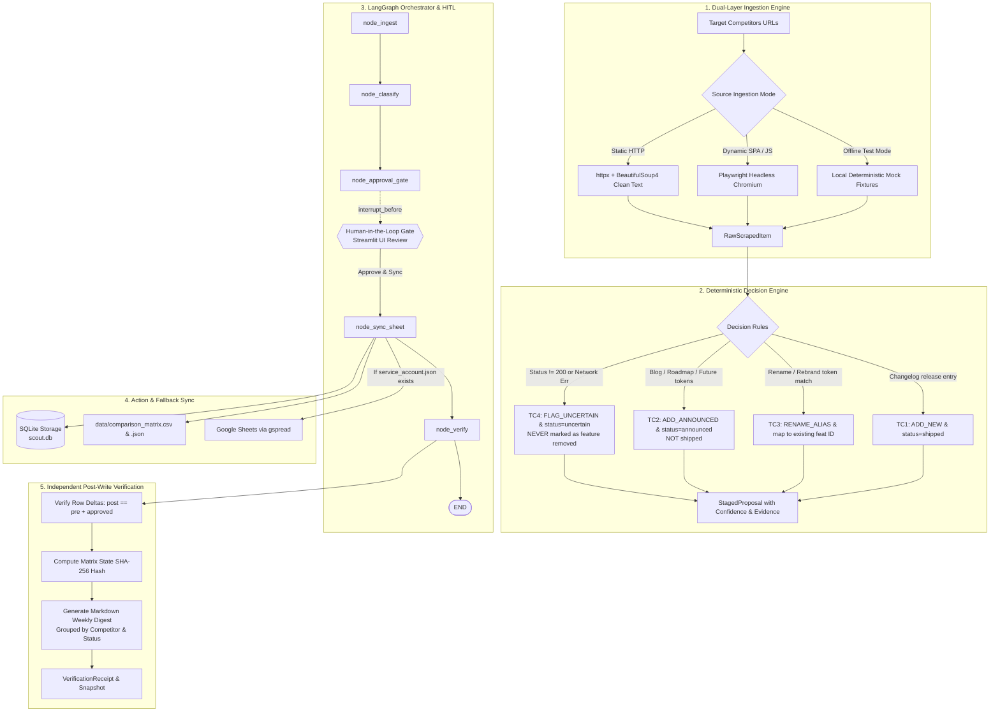

# 🛰️ Competitor Changelog Scout — Enterprise Agentic AI Workflow

**Submitted to the Developer & Enterprise AI Track | Ziro National Agentic AI Hackathon 2026**

Competitor Changelog Scout is an autonomous agentic competitive intelligence system designed for enterprise product and engineering teams. It continuously monitors, extracts, and reconciles public release notes, product changelogs, and marketing feeds from competitors, enforcing strict deterministic decision gates, an interruptible LangGraph Human-in-the-Loop (HITL) approval gate, resilient Google Sheets/CSV dual-ledger synchronization, and post-write SHA-256 cryptographic state verification.

---

## 🏛️ System Architecture



---

## 🎯 Deterministic Decision Rules

The classifier ([core/classifier.py](core/classifier.py)) evaluates every raw item against four deterministic test case gates:

| Gate | Scenario | Condition / Trigger | Staged Action | Lifecycle Status | Hard Rule Guarantee |
| :--- | :--- | :--- | :--- | :--- | :--- |
| **TC1** | **New Feature in Changelog** | Clean release note on official changelog URL | `ADD_NEW` | `shipped` | Extracted date, clean title, valid source link, confidence >= 0.95 |
| **TC2** | **Marketing Post Only** | Source is blog post OR contains future roadmap markers (`coming soon`, `planned`, `announcing`, `preview`) | `ADD_ANNOUNCED` | `announced` | **EXPLICITLY NEVER** marked as `shipped` |
| **TC3** | **Feature Renamed / Rebranded** | Mention of known feature name/alias with rename markers (`renamed`, `rebranded`, `now called`, `replaces`) | `RENAME_ALIAS` | `shipped` | **Reconciles with existing feature ID** (e.g. `feat_jira_imp`), maps new alias, and preserves stable identity |
| **TC4** | **Page Removed / 404 / Network Error** | HTTP status != 200 or connection timeout / fetch error | `FLAG_UNCERTAIN` | `uncertain` | **EXPLICITLY NEVER** marked as "feature removed". Registry intact |

---

## 🛑 Mandatory Human-in-the-Loop (HITL) Gate

The agent state machine ([core/graph.py](core/graph.py)) is compiled using LangGraph and an in-memory checkpointer (`MemorySaver`):

```python
builder = StateGraph(AgentState)
# Ingestion -> Classification -> Approval Gate (Pause) -> Sheet Sync -> Verification
builder.add_edge(START, "ingest")
builder.add_edge("ingest", "classify")
builder.add_edge("classify", "approval_gate")
builder.add_edge("approval_gate", "sync_sheet")
builder.add_edge("sync_sheet", "verify")
builder.add_edge("verify", END)

graph = builder.compile(
    checkpointer=MemorySaver(),
    interrupt_before=["approval_gate"],
)
```

1. **Inspection**: The agent stages all proposals with confidence scores, classification reasoning, and exact <= 150 character evidence quotes.
2. **Interruption**: Execution halts before `approval_gate`. **Zero writes** occur to the database or comparison matrix without human approval.
3. **Resumption**: The human operator selectively approves, modifies, or rejects proposals in the Streamlit UI, triggering `graph.update_state()` and resuming the DAG.

---

## 💾 Resilient Action Execution & Dual-Ledger Sync

When approved proposals are committed ([core/sheet_sync.py](core/sheet_sync.py)):
1. **Local SQLite Ledger**: Feature registry and proposal records are updated transactionally in [storage/db.py](storage/db.py).
2. **Local Comparison Matrix**: Automatically exported to `data/comparison_matrix.csv` and `data/comparison_matrix.json`.
3. **Google Sheets Sync (`gspread`)**: If a Google service account key is available (`service_account.json`), the agent updates the cloud spreadsheet. If missing or rate-limited, it logs:
   > `Operating in resilient local-ledger mode (CSV/JSON active).`
   and executes with zero failure.

---

## 🔍 Step 5 Independent Verification & Digest

Post-write integrity is guaranteed by an independent verification engine ([core/verifier.py](core/verifier.py)):
- **Row Delta Audit**: Validates `post_count == pre_count + expected_new_features`.
- **SHA-256 State Fingerprint**: Computes a canonical hash across all feature rows and logs an immutable audit snapshot into the `weekly_snapshots` table.
- **Weekly Markdown Digest**: Compiles a GitHub-ready intelligence report grouped by Competitor and Status (`[SHIPPED]`, `[ANNOUNCED]`, `[UNCERTAIN]`), featuring dates, direct source URLs, and expandable evidence quotes.

---

## 📁 Repository File Structure

```text
ziro-hackathon-agentic-ai/
├── requirements.txt            # Production dependencies
├── README.md                   # Architecture & usage documentation
├── app.py                      # Enterprise Streamlit dashboard (Trace, HITL, Matrix, Test Runner)
├── core/
│   ├── __init__.py
│   ├── schemas.py              # Strict Pydantic v2 data models & enums
│   ├── ingestion.py            # Dual-layer fetcher (httpx static + bs4, local Playwright fallback)
│   ├── classifier.py           # Deterministic decision rules for TC1, TC2, TC3, TC4
│   ├── graph.py                # LangGraph state machine with HITL interrupt_before
│   ├── sheet_sync.py           # Batch write adapter for Google Sheets / local CSV fallback
│   └── verifier.py             # Step 5 independent post-write diff & digest generator
├── storage/
│   ├── __init__.py
│   ├── db.py                   # SQLite repository with SQLAlchemy for state & registry
│   └── scout.db                # SQLite database (auto-generated)
├── fixtures/
│   ├── __init__.py
│   └── mock_data.py            # Local HTML and raw response fixtures for TC1-TC4
├── data/                       # Auto-generated CSV and JSON comparison ledgers
│   ├── comparison_matrix.csv
│   └── comparison_matrix.json
└── tests/
    ├── __init__.py
    └── test_official_suite.py  # Pytest suite asserting 100% compliance on TC1-TC4
```

---

## 🚀 Quickstart & Execution

### 1. Environment Setup

```bash
# Clone the repository and navigate to root
cd ziro-hackathon-agentic-ai

# Create and activate Python virtual environment
python -m venv venv
# On Windows:
venv\Scripts\activate
# On Linux/macOS:
# source venv/bin/activate

# Install dependencies
pip install -r requirements.txt
playwright install chromium
```

### 2. Run the Official Test Suite (Under 5s, Zero Internet)

```bash
pytest tests/test_official_suite.py -v
```

Expected output:
```text
rootdir: .
collected 8 items

tests/test_official_suite.py::test_tc1_new_feature_changelog PASSED      [ 12%]
tests/test_official_suite.py::test_tc2_marketing_post_announced PASSED   [ 25%]
tests/test_official_suite.py::test_tc3_feature_renamed_alias PASSED      [ 37%]
tests/test_official_suite.py::test_tc4_missing_page_uncertain PASSED     [ 50%]
tests/test_official_suite.py::test_deterministic_execution_speed PASSED  [ 62%]
tests/test_official_suite.py::test_hitl_approval_interruption PASSED     [ 75%]
tests/test_official_suite.py::test_resilient_ledger_fallback PASSED      [ 87%]
tests/test_official_suite.py::test_verification_sha256_receipt_and_digest PASSED [100%]

============================== 8 passed in 3.38s ==============================
```

### 3. Launch the Interactive Enterprise Dashboard

```bash
streamlit run app.py
```

The Streamlit dashboard opens in your browser at `http://localhost:8501`.

---

## 🧪 Verification Walkthrough

1. **Tab 1 (Live Scout & Runner)**:
   - Select **Target Competitor**: `Linear`.
   - Select **Scan Source Mode**: `Deterministic Mock Scenarios (Fast & Offline)`.
   - Select scenario: `Full Multi-Source Batch (TC1 - TC4)`.
   - Click **Run Agentic Scout Pipeline**. Observe the live agent reasoning trace pausing at the HITL gate.
2. **Tab 2 (Human Approval Gate)**:
   - Review the staged diff cards showing status badges (`[SHIPPED]`, `[ANNOUNCED]`, `[UNCERTAIN]`), confidence scores, and evidence quotes.
   - Select the desired proposals and click **Approve & Sync Selected to Matrix**.
3. **Tab 3 (Matrix & Weekly Digest)**:
   - Inspect the compiled Markdown Weekly Digest.
   - Review the cryptographic verification receipt and download the `comparison_matrix.csv` / `.json`.
4. **Tab 4 (Official Test Runner)**:
   - Click **Run Official Test Suite (TC1–TC4)** to trigger the full `pytest` suite directly within the UI, displaying live green checkmarks.
