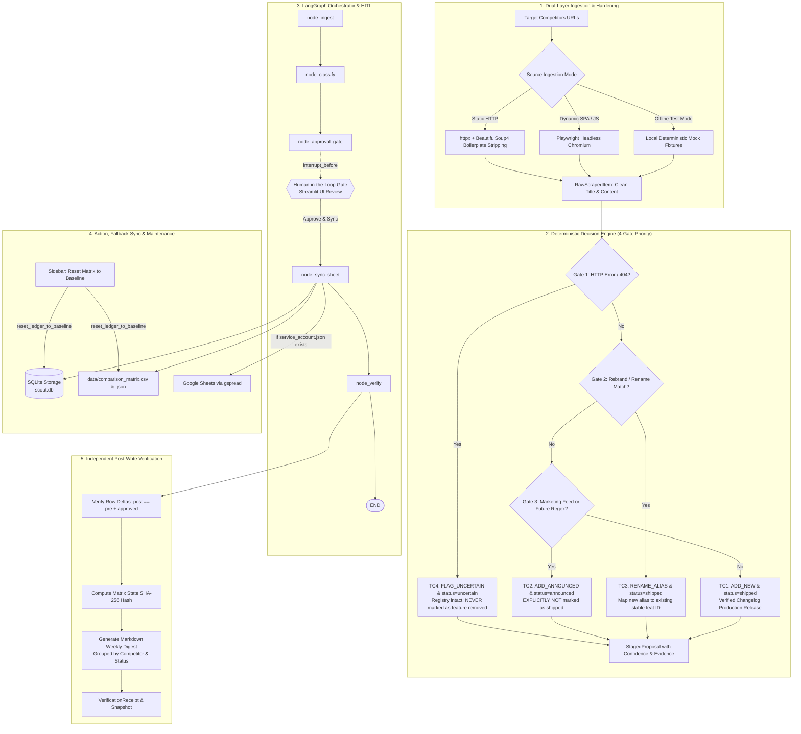

# 🛰️ Competitor Changelog Scout — Enterprise Agentic AI Workflow

**Submitted to the Developer & Enterprise AI Track | Ziro National Agentic AI Hackathon 2026**

Competitor Changelog Scout is an autonomous agentic competitive intelligence system designed for enterprise product and engineering teams. It continuously monitors, extracts, and reconciles public release notes, product changelogs, and marketing feeds from competitors, enforcing strict deterministic decision gates, an interruptible LangGraph Human-in-the-Loop (HITL) approval gate, resilient Google Sheets/CSV dual-ledger synchronization, baseline ledger resetting, and post-write SHA-256 cryptographic state verification.

---

## 🏛️ System Architecture



---

## 🎯 Deterministic Decision Rules & Ingestion Hardening

The classifier ([core/classifier.py](core/classifier.py)) evaluates every scraped item against a strict, deterministic 4-gate priority hierarchy (`TC4` ➔ `TC3` ➔ `TC2` ➔ `TC1`):

| Priority | Gate | Scenario | Condition / Trigger | Staged Action | Lifecycle Status | Hard Rule Guarantee |
| :--- | :--- | :--- | :--- | :--- | :--- | :--- |
| **1st** | **TC4** | **Page Removed / 404 / Network Error** | HTTP status != 200 or connection timeout / fetch error | `FLAG_UNCERTAIN` | `uncertain` | **EXPLICITLY NEVER** marked as "feature removed". Registry intact |
| **2nd** | **TC3** | **Feature Renamed / Rebranded** | Mention of known feature name/alias with rename markers (`renamed`, `rebranded`, `now called`, `replaces`) | `RENAME_ALIAS` | `shipped` | **Reconciles with existing feature ID** (`feat_jira_imp`), maps new alias, and preserves stable identity |
| **3rd** | **TC2** | **Marketing Post / Roadmap Preview** | Source is non-changelog blog (`/blog`) OR title explicitly matches future regex | `ADD_ANNOUNCED` | `announced` | **EXPLICITLY NEVER** marked as `shipped` |
| **4th** | **TC1** | **New Feature in Changelog** | Official changelog feed release note without forward-looking title markers | `ADD_NEW` | `shipped` | Extracted release date, clean title, source link, confidence >= 0.95 |

### Ingestion Hardening & Greedy Collision Elimination
- **Aggressive Boilerplate Deconstruction** ([core/ingestion.py](core/ingestion.py)): Automatically strips `<head>`, `<nav>`, `<header>`, `<footer>`, `<aside>`, `<script>`, `<style>`, and `<noscript>` elements before text parsing. Navigation menu links (e.g., header links containing "roadmap" or "preview") never leak into `raw_content`.
- **Context-Aware Headline Extraction** ([core/ingestion.py](core/ingestion.py)): Prioritizes first `<h1>`, `<h2>`, or `<h3>` within `<article>`, `<main>`, or `.changelog` containers rather than defaulting to generic site `<title>` tags (e.g., "Changelog – Linear").
- **Strict Word-Boundary Regex** ([core/classifier.py](core/classifier.py)): Restricts forward-looking indicators to exact phrases via `\b(coming soon|planned for|next quarter|in beta|preview release|will roll out|upcoming)\b`. For official changelog pages, roadmap checks are constrained to entry titles to avoid false-positive `ADD_ANNOUNCED` classifications on shipped releases.

---

## ⚡ Dynamic URL Synchronization

In the Streamlit dashboard ([app.py](app.py)), dynamic URL synchronization solves the persistent session state caching issue common in Streamlit widget state management:

- **Feed Mapping Registry**: Pre-configures canonical feeds across monitored competitors:
  ```python
  COMPETITOR_URL_MAP = {
      "LINEAR - Official Feeds": "https://linear.app/changelog",
      "JIRA - Official Feeds": "https://confluence.atlassian.com/jirasoftware/jira-software-release-notes",
      "SUPABASE - Official Feeds": "https://supabase.com/changelog",
      "Custom URL": "",
  }
  ```
- **Synchronous `on_change` Callback**: When changing the "Target Competitor" dropdown, `on_competitor_change()` updates `st.session_state.custom_scrape_url` before the rerun renders.
- **Key-Bound Input Widget**: `st.text_input` binds directly to `key="custom_scrape_url"` without a hardcoded `value=` argument, ensuring the input box updates synchronously while remaining fully editable for custom URLs.

---

## 🛑 Mandatory Human-in-the-Loop (HITL) Gate

The agent state machine ([core/graph.py](core/graph.py)) is compiled using LangGraph and an in-memory checkpointer (`MemorySaver`):

```python
builder = StateGraph(AgentState)
# Ingestion -> Classification -> Approval Gate (Pause) -> Sheet Sync -> Verification
builder.add_edge(START, "ingest")
builder.add_edge("ingest", "classify")
builder.add_edge("classify", "approval_gate")
builder.add_edge("approval_gate", "sync_sheet")
builder.add_edge("sync_sheet", "verify")
builder.add_edge("verify", END)

graph = builder.compile(
    checkpointer=MemorySaver(),
    interrupt_before=["approval_gate"],
)
```

1. **Inspection**: The agent stages all proposals with confidence scores, classification reasoning, and exact <= 150 character evidence quotes.
2. **Interruption**: Execution halts before `approval_gate`. **Zero writes** occur to the database or comparison matrix without human approval.
3. **Resumption**: The human operator selectively approves, modifies, or rejects proposals in the Streamlit UI, triggering `graph.update_state()` and resuming the DAG.

---

## 💾 Resilient Action Execution & Dual-Ledger Sync

When approved proposals are committed ([core/sheet_sync.py](core/sheet_sync.py)):
1. **Local SQLite Ledger**: Feature registry and proposal records are updated transactionally in [storage/db.py](storage/db.py).
2. **Local Comparison Matrix**: Automatically exported to `data/comparison_matrix.csv` and `data/comparison_matrix.json`.
3. **Google Sheets Sync (`gspread`)**: If a Google service account key is available (`service_account.json`), the agent updates the cloud spreadsheet. If missing or rate-limited, it logs:
   > `Operating in resilient local-ledger mode (CSV/JSON active).`
   and executes with zero failure.

---

## 🧹 Ledger Baseline Reset Mechanism

To support repeatable testing and live demonstrations without manual database manipulation, the system includes a one-click clean seed baseline reset:

- **Storage Reset** ([storage/db.py](storage/db.py)): `reset_db_to_baseline(session)` purges all test proposals from `ProposalModel` and rogue features from `FeatureModel`, while restoring the initial seed feature `feat_jira_imp` ("Jira Importer", `shipped`) and the three standard competitors (`linear`, `jira`, `supabase`). Calls `session.commit()` and `session.expire_all()` to refresh SQLAlchemy's identity map.
- **Dual-Ledger Reset** ([core/sheet_sync.py](core/sheet_sync.py)): `reset_ledger_to_baseline()` resets `data/comparison_matrix.json` and `data/comparison_matrix.csv` to a single clean baseline entry:
  ```json
  [
    {
      "Competitor ID": "linear",
      "Competitor Name": "Linear",
      "Feature ID": "feat_jira_imp",
      "Feature Name": "Jira Importer",
      "Status": "shipped",
      "Aliases": "Legacy Importer",
      "Source URL": "https://linear.app/changelog/legacy-importer",
      "Last Updated": "2026-10-15T00:00:00"
    }
  ]
  ```
- **Streamlit Action**: Accessible in the sidebar via `🧹 Reset Matrix to Clean Baseline` under `🧹 Database & Ledger Maintenance`. Clears pending proposals, resets execution traces, displays a confirmation notification, and reruns the UI with a 1-row registry.
- **TC3 Continuity**: Preserving `feat_jira_imp` as the baseline feature ensures that TC3 (semantic rebrand to "Universal Workspace Sync") always reconciles to a known feature ID.

---

## 🔍 Step 5 Independent Verification & Digest

Post-write integrity is guaranteed by an independent verification engine ([core/verifier.py](core/verifier.py)):
- **Row Delta Audit**: Validates `post_count == pre_count + expected_new_features`.
- **SHA-256 State Fingerprint**: Computes a canonical hash across all feature rows and logs an immutable audit snapshot into the `weekly_snapshots` table.
- **Weekly Markdown Digest**: Compiles a GitHub-ready intelligence report grouped by Competitor and Status (`[SHIPPED]`, `[ANNOUNCED]`, `[UNCERTAIN]`), featuring dates, direct source URLs, and expandable evidence quotes.

---

## 📁 Repository File Structure

```text
ziro-hackathon-agentic-ai/
├── requirements.txt            # Production dependencies
├── README.md                   # Architecture & system documentation
├── WALKTHROUGH.md              # Engineering walkthrough & component guide
├── app.py                      # Enterprise Streamlit dashboard (Trace, HITL, Matrix, Test Runner)
├── core/
│   ├── __init__.py
│   ├── schemas.py              # Strict Pydantic v2 data models & enums
│   ├── ingestion.py            # Dual-layer fetcher (httpx static + bs4, Playwright fallback)
│   ├── classifier.py           # Deterministic decision rules for TC1, TC2, TC3, TC4
│   ├── graph.py                # LangGraph state machine with HITL interrupt_before
│   ├── sheet_sync.py           # Batch write adapter for Google Sheets / local CSV fallback / Reset
│   └── verifier.py             # Step 5 independent post-write diff & digest generator
├── storage/
│   ├── __init__.py
│   ├── db.py                   # SQLite repository with SQLAlchemy for state & registry
│   └── scout.db                # SQLite database (auto-generated)
├── fixtures/
│   ├── __init__.py
│   └── mock_data.py            # Local HTML and raw response fixtures for TC1-TC4
├── data/                       # Auto-generated CSV and JSON comparison ledgers
│   ├── comparison_matrix.csv
│   └── comparison_matrix.json
├── scripts/
│   └── verify_ui.py            # Pre-push validation script running all suites
└── tests/
    ├── __init__.py
    ├── test_official_suite.py  # Pytest suite asserting 100% compliance across TC1-TC4 & Reset
    └── test_ui_interactions.py # Headless Streamlit AppTest suite verifying all interactive UI states
```

---

## 🚀 Quickstart & Execution

### 1. Environment Setup

```bash
# Clone the repository and navigate to root
cd ziro-hackathon-agentic-ai

# Create and activate Python virtual environment
python -m venv venv
# On Windows:
venv\Scripts\activate
# On Linux/macOS:
# source venv/bin/activate

# Install dependencies
pip install -r requirements.txt
playwright install chromium
```

### 2. Run Test Suites & Pre-Push Verification

#### A. Official Compliance Suite (Under 5s, Zero Internet)
```bash
pytest tests/test_official_suite.py -v
```

#### B. Headless Streamlit UI Interaction Suite
```bash
pytest tests/test_ui_interactions.py -v
```

#### C. One-Click Pre-Push Verification
```bash
python scripts/verify_ui.py
```

Expected output:
```text
======================================================================
🚀 RUNNING FULL END-TO-END VERIFICATION SUITE...
======================================================================
============================= test session starts =============================
...
tests/test_official_suite.py::test_tc1_new_feature_changelog PASSED      [  6%]
...
tests/test_ui_interactions.py::test_ui_tab4_test_runner PASSED          [100%]

============================== 16 passed in 23.36s ==============================

======================================================================
✅ ALL UI BUTTONS, SYNC CONTROLS, AND LOGIC VERIFIED. SAFE TO COMMIT AND PUSH.
======================================================================
```

### 3. Launch the Interactive Enterprise Dashboard

```bash
streamlit run app.py
```

The Streamlit dashboard opens in your browser at `http://localhost:8501`.

---

## 🧪 Verification Walkthrough

1. **Sidebar (Tracked Competitors & Maintenance)**:
   - View tracked competitors (`Linear`, `Atlassian Jira`, `Supabase`) and active system specifications.
   - Click **`🧹 Reset Matrix to Clean Baseline`** to reset SQLite storage and dual ledgers to the initial seed baseline.
2. **Tab 1 (Live Scout & Runner)**:
   - Select **Target Competitor**: `LINEAR - Official Feeds`, `JIRA - Official Feeds`, `SUPABASE - Official Feeds`, or `Custom URL`. Observe the URL field update dynamically.
   - Select **Scan Source Mode**: `Deterministic Mock Scenarios (Fast & Offline)`.
   - Select scenario: `Full Multi-Source Batch (TC1 - TC4)`.
   - Click **Run Agentic Scout Pipeline**. Observe the live agent reasoning trace pausing at the HITL gate.
3. **Tab 2 (Human Approval Gate)**:
   - Review the staged diff cards showing status badges (`[SHIPPED]`, `[ANNOUNCED]`, `[UNCERTAIN]`), confidence scores, and evidence quotes.
   - Select the desired proposals and click **Approve & Sync Selected to Matrix**.
4. **Tab 3 (Matrix & Weekly Digest)**:
   - Inspect the compiled Markdown Weekly Digest.
   - Review the cryptographic verification receipt and download the `comparison_matrix.csv` / `.json`.
5. **Tab 4 (Official Test Runner)**:
   - Click **Run Official Test Suite (TC1–TC4)** to trigger the full `pytest` suite directly within the UI, displaying live green checkmarks.
