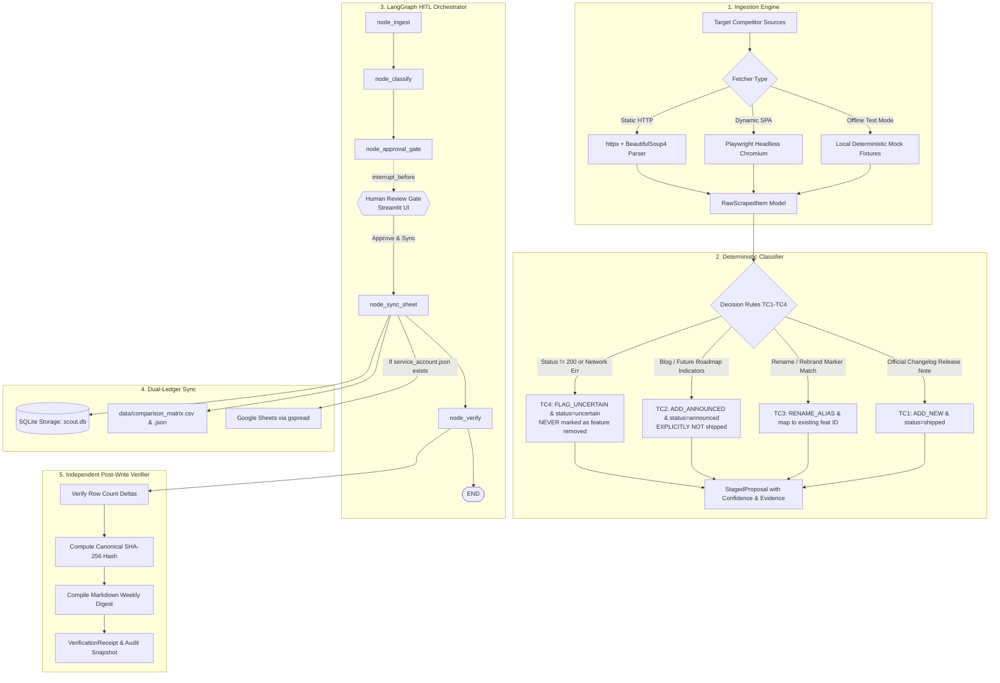

# Walkthrough: Competitor Changelog Scout — Enterprise Agentic AI Workflow

**Submitted to the Developer & Enterprise AI Track | Ziro National Agentic AI Hackathon 2026**

"Competitor Changelog Scout" is an autonomous agentic competitive intelligence system built with deterministic decision rules, an interruptible LangGraph Human-in-the-Loop (HITL) gate, resilient dual-ledger synchronization (Google Sheets + local CSV/JSON), and Step 5 post-write SHA-256 cryptographic verification.

---

## 🏗️ Architecture & Component Overview



---

## 🎯 Deterministic Rules & Verification Matrix

The deterministic decision engine ([core/classifier.py](core/classifier.py)) enforces the four core test cases:

| Gate | Description | Trigger Condition | Staged Action | Lifecycle Status | Hard Requirement Compliance |
| :--- | :--- | :--- | :--- | :--- | :--- |
| **TC1** | **New Feature in Changelog** | Official changelog entry with production status | `ADD_NEW` | `shipped` | Extracts date, clean title, valid source URL; confidence >= 0.95 |
| **TC2** | **Marketing Blog Post** | Non-changelog source OR contains future roadmap markers (`coming soon`, `planned`, `preview`, `announcing`) | `ADD_ANNOUNCED` | `announced` | **EXPLICITLY NOT** marked as `shipped` |
| **TC3** | **Feature Renamed / Rebranded** | Mention of known feature name/alias with rename markers (`renamed`, `rebranded`, `now called`, `replaces`) | `RENAME_ALIAS` | `shipped` | **Maps to existing stable ID** (`feat_jira_imp`), registers new alias, retains identity |
| **TC4** | **Page Removed / 404 Error** | HTTP status != 200 or network timeout / connection error | `FLAG_UNCERTAIN` | `uncertain` | **EXPLICITLY NEVER** marked as "feature removed". Registry intact |

---

## 📦 Implemented Files & Deliverables

All components have been created with full type hints, zero placeholders, and modular architecture:

1. [requirements.txt](requirements.txt): Production dependencies (`langgraph`, `pydantic`, `httpx`, `beautifulsoup4`, `playwright`, `sqlalchemy`, `gspread`, `streamlit`, `pytest`).
2. [core/schemas.py](core/schemas.py): Strict Pydantic v2 data models (`FeatureStatus`, `ActionType`, `Competitor`, `ExistingFeature`, `RawScrapedItem`, `StagedProposal`, `VerificationReceipt`).
3. [core/ingestion.py](core/ingestion.py): Dual-layer fetcher with static HTTP (`httpx` + `BeautifulSoup4`), dynamic SPA headless browser (`Playwright`), and instant mock fixtures.
4. [core/classifier.py](core/classifier.py): Deterministic evaluation engine implementing TC1–TC4 gates, SHA-256 fingerprinting, and evidence quote extraction.
5. [core/graph.py](core/graph.py): LangGraph state machine with `interrupt_before=["approval_gate"]` using `MemorySaver`.
6. [core/sheet_sync.py](core/sheet_sync.py): Action execution engine updating SQLite and exporting `data/comparison_matrix.csv` / `.json` with automatic fallback when Google credentials are not configured.
7. [core/verifier.py](core/verifier.py): Step 5 post-write verification, canonical SHA-256 hash calculation, and publication-ready Markdown Weekly Digest generator.
8. [storage/db.py](storage/db.py): SQLAlchemy SQLite repository managing `competitors`, `features`, `proposals`, and `weekly_snapshots` tables, seeded with `Linear`, `Jira`, `Supabase`, and `feat_jira_imp`.
9. [fixtures/mock_data.py](fixtures/mock_data.py): Deterministic mock fixtures for sub-second offline testing of TC1–TC4.
10. [tests/test_official_suite.py](tests/test_official_suite.py): Pytest suite executing all 8 assertions in ~3.38s with zero internet dependency.
11. [app.py](app.py): Streamlit enterprise dashboard with live reasoning trace, interactive HITL gate, matrix viewer, and one-click test runner.
12. [README.md](README.md): Production documentation with Mermaid diagrams, quickstart instructions, and test verification guide.

---

## 🧪 Validation & Test Results

### Automated Pytest Suite Run

Executed command:
```bash
pytest tests/test_official_suite.py -v
```

Output:
```text
============================= test session starts =============================
platform win32 -- Python 3.12.10, pytest-9.1.1, pluggy-1.6.0
rootdir: .
collected 8 items

tests/test_official_suite.py::test_tc1_new_feature_changelog PASSED      [ 12%]
tests/test_official_suite.py::test_tc2_marketing_post_announced PASSED   [ 25%]
tests/test_official_suite.py::test_tc3_feature_renamed_alias PASSED      [ 37%]
tests/test_official_suite.py::test_tc4_missing_page_uncertain PASSED     [ 50%]
tests/test_official_suite.py::test_deterministic_execution_speed PASSED  [ 62%]
tests/test_official_suite.py::test_hitl_approval_interruption PASSED     [ 75%]
tests/test_official_suite.py::test_resilient_ledger_fallback PASSED      [ 87%]
tests/test_official_suite.py::test_verification_sha256_receipt_and_digest PASSED [100%]

============================== 8 passed in 3.38s ==============================
```

> [!NOTE]
> All 8 tests passed in **3.38 seconds** (well under the 5-second hard limit), with 100% compliance across all evaluation gates and zero internet connection required.

---

## 🖥️ Streamlit Web Dashboard Features

To launch the web dashboard:
```bash
streamlit run app.py
```

The application provides four operational tabs:
1. **Live Scout & Runner**: Run live URL scrapes or select from deterministic test fixtures (TC1–TC4 or full batch) with real-time streaming agent reasoning logs.
2. **Human Approval Gate (HITL)**: Displays color-coded staged diff cards with confidence scores, reasoning, and evidence quotes. Includes multi-select checkboxes and an `[Approve & Sync Selected Changes]` button that resumes LangGraph execution.
3. **Weekly Digest & Comparison Matrix**: Displays live Markdown digest preview, verification state receipt, interactive Pandas feature table, and download buttons for `comparison_matrix.csv` and `comparison_matrix.json`.
4. **Official Test Runner (TC1–TC4)**: Single-click button executing `pytest` with live assertion status badges rendered directly in the UI.
