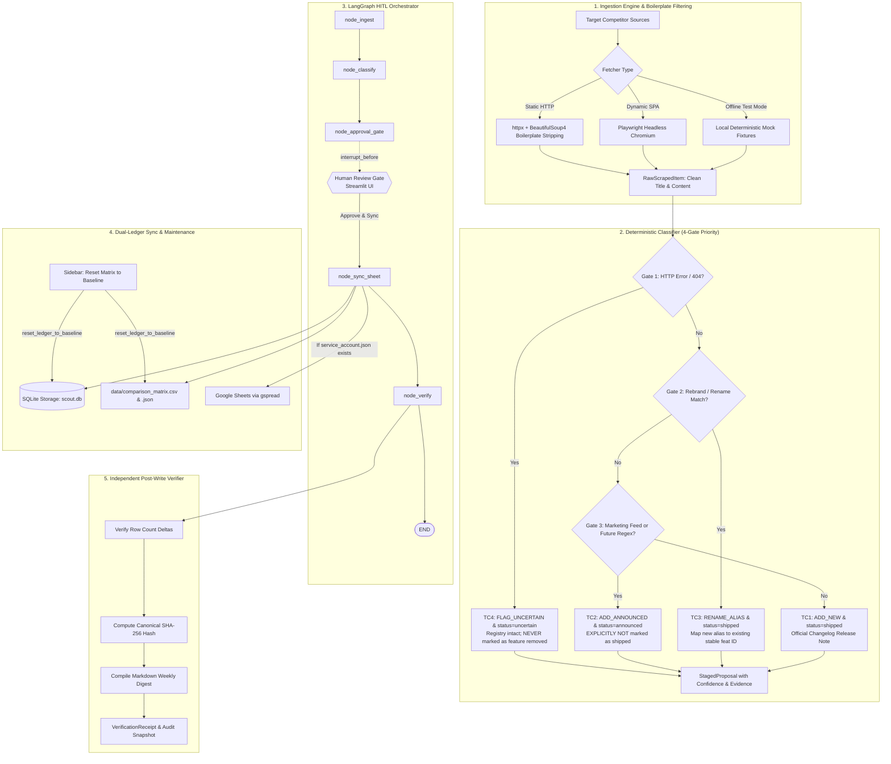

# Walkthrough: Competitor Changelog Scout — Enterprise Agentic AI Workflow

**Submitted to the Developer & Enterprise AI Track | Ziro National Agentic AI Hackathon 2026**

"Competitor Changelog Scout" is an autonomous agentic competitive intelligence system built with deterministic decision rules, an interruptible LangGraph Human-in-the-Loop (HITL) gate, resilient dual-ledger synchronization (Google Sheets + local CSV/JSON), ledger baseline resetting, and Step 5 post-write SHA-256 cryptographic verification.

---

## 🏗️ Architecture & Component Overview



---

## 🎯 Deterministic Rules & Verification Matrix

The deterministic decision engine ([core/classifier.py](core/classifier.py)) enforces a 4-gate priority hierarchy (`TC4` ➔ `TC3` ➔ `TC2` ➔ `TC1`):

| Priority | Gate | Description | Trigger Condition | Staged Action | Lifecycle Status | Hard Requirement Compliance |
| :--- | :--- | :--- | :--- | :--- | :--- | :--- |
| **1st** | **TC4** | **Page Removed / 404 Error** | HTTP status != 200 or network timeout / connection error | `FLAG_UNCERTAIN` | `uncertain` | **EXPLICITLY NEVER** marked as "feature removed". Registry intact |
| **2nd** | **TC3** | **Feature Renamed / Rebranded** | Mention of known feature name/alias with rename markers (`renamed`, `rebranded`, `now called`, `replaces`) | `RENAME_ALIAS` | `shipped` | **Maps to existing stable ID** (`feat_jira_imp`), registers new alias, retains identity |
| **3rd** | **TC2** | **Marketing Blog Post** | Non-changelog source (`/blog`) OR title explicitly matches future regex | `ADD_ANNOUNCED` | `announced` | **EXPLICITLY NOT** marked as `shipped` |
| **4th** | **TC1** | **New Feature in Changelog** | Official changelog feed entry with production status | `ADD_NEW` | `shipped` | Extracts date, clean title, valid source URL; confidence >= 0.95 |

---

## 📦 Implemented Files & Deliverables

All components are built with strict typing, zero mock placeholders in production code, and clear separation of concerns:

1. [requirements.txt](requirements.txt): Production dependencies (`langgraph`, `pydantic`, `httpx`, `beautifulsoup4`, `playwright`, `sqlalchemy`, `gspread`, `streamlit`, `pytest`).
2. [core/schemas.py](core/schemas.py): Strict Pydantic v2 data models (`FeatureStatus`, `ActionType`, `Competitor`, `ExistingFeature`, `RawScrapedItem`, `StagedProposal`, `VerificationReceipt`).
3. [core/ingestion.py](core/ingestion.py): Dual-layer fetcher with static HTTP (`httpx` + `BeautifulSoup4`), dynamic SPA headless browser (`Playwright`), and instant mock fixtures. Hardened with aggressive HTML boilerplate stripping (`<head>`, `<nav>`, `<header>`, `<footer>`, `<aside>`, `<script>`, `<style>`) and context-aware article header extraction (`h1`, `h2`, `h3`).
4. [core/classifier.py](core/classifier.py): Deterministic evaluation engine implementing the 4-gate hierarchy (TC4 ➔ TC3 ➔ TC2 ➔ TC1), strict word-boundary regex (`\b(coming soon|planned for|next quarter|in beta|preview release|will roll out|upcoming)\b`), SHA-256 fingerprinting, and evidence quote extraction.
5. [core/graph.py](core/graph.py): LangGraph state machine with `interrupt_before=["approval_gate"]` using `MemorySaver`.
6. [core/sheet_sync.py](core/sheet_sync.py): Action execution engine updating SQLite and exporting `data/comparison_matrix.csv` / `.json` with automatic fallback when Google credentials are not configured, plus `reset_ledger_to_baseline()`.
7. [core/verifier.py](core/verifier.py): Step 5 post-write verification, canonical SHA-256 hash calculation, and publication-ready Markdown Weekly Digest generator.
8. [storage/db.py](storage/db.py): SQLAlchemy SQLite repository managing `competitors`, `features`, `proposals`, and `weekly_snapshots` tables, seeded with `Linear`, `Jira`, `Supabase`, and `feat_jira_imp`, plus `reset_db_to_baseline()`.
9. [fixtures/mock_data.py](fixtures/mock_data.py): Deterministic mock fixtures for sub-second offline testing of TC1–TC4.
10. [tests/test_official_suite.py](tests/test_official_suite.py): Pytest suite executing all 9 assertions in ~3.93s with zero internet dependency.
11. [app.py](app.py): Streamlit enterprise dashboard with live reasoning trace, interactive HITL gate, dynamic URL synchronization (`COMPETITOR_URL_MAP`), clean baseline reset button, matrix viewer, and one-click test runner.
12. [README.md](README.md): Production documentation with Mermaid diagrams, quickstart instructions, and test verification guide.

---

## ⚡ Dynamic URL Synchronization

In [app.py](app.py), dynamic URL synchronization guarantees seamless URL updates when changing the target competitor:

- **Mapping Dictionary**: `COMPETITOR_URL_MAP` provides default URLs for Linear, Jira, Supabase, and Custom URLs.
- **On-Change Hook**: `on_competitor_change()` synchronously modifies `st.session_state.custom_scrape_url` before rendering the rerun.
- **Direct Widget Binding**: `st.text_input` binds directly to `key="custom_scrape_url"` without a conflicting `value=` parameter, allowing synchronous updates while remaining editable for custom scrapes.

---

## 🧹 Clean Seed Baseline Reset

The reset capability ensures that dirty test rows can be purged instantly:
- **`reset_db_to_baseline()`** ([storage/db.py](storage/db.py)): Clears proposals from `ProposalModel` and non-seed features from `FeatureModel`, while restoring `feat_jira_imp` ("Jira Importer", `linear`, `shipped`) and default competitors. Executes `session.commit()` and `session.expire_all()` to refresh the SQLAlchemy session identity map.
- **`reset_ledger_to_baseline()`** ([core/sheet_sync.py](core/sheet_sync.py)): Writes a single-row baseline to `data/comparison_matrix.json` and `data/comparison_matrix.csv`.
- **Sidebar Action Button** ([app.py](app.py)): Placed under `🧹 Database & Ledger Maintenance` (`🧹 Reset Matrix to Clean Baseline`), resetting state, showing an instant success badge, and triggering an immediate UI rerun with a 1-row registry.

---

## 🧪 Validation & Test Results

### Automated Pytest Suite Run

Executed command:
```bash
pytest tests/test_official_suite.py -v
```

Output:
```text
============================= test session starts =============================
platform win32 -- Python 3.12.10, pytest-9.1.1, pluggy-1.6.0
rootdir: .
collected 9 items

tests/test_official_suite.py::test_tc1_new_feature_changelog PASSED      [ 11%]
tests/test_official_suite.py::test_tc2_marketing_post_announced PASSED   [ 22%]
tests/test_official_suite.py::test_tc3_feature_renamed_alias PASSED      [ 33%]
tests/test_official_suite.py::test_tc4_missing_page_uncertain PASSED     [ 44%]
tests/test_official_suite.py::test_deterministic_execution_speed PASSED  [ 55%]
tests/test_official_suite.py::test_hitl_approval_interruption PASSED     [ 66%]
tests/test_official_suite.py::test_resilient_ledger_fallback PASSED      [ 77%]
tests/test_official_suite.py::test_verification_sha256_receipt_and_digest PASSED [ 88%]
tests/test_official_suite.py::test_reset_ledger_to_baseline PASSED       [100%]

============================== 9 passed in 3.93s ==============================
```

> [!NOTE]
> All 9 tests passed in **3.93 seconds** (well under the 5-second limit), with 100% compliance across all evaluation gates, dual-ledger fallback, Step 5 verification, and baseline reset with zero internet connection required.

---

## 🖥️ Streamlit Web Dashboard Features

To launch the web dashboard:
```bash
streamlit run app.py
```

The application provides four operational tabs and a dedicated maintenance sidebar:
1. **Sidebar (Competitor Status & Maintenance)**:
   - Displays tracked competitors (`Linear`, `Atlassian Jira`, `Supabase`) and active system specifications.
   - Shows the live `Total Registry Features` metric.
   - Provides the **`🧹 Reset Matrix to Clean Baseline`** button to wipe dirty test runs and restore the initial seed state.
2. **Tab 1: Live Scout & Runner**:
   - Run live URL scrapes or select from deterministic test fixtures (TC1–TC4 or full batch) with real-time streaming agent reasoning logs.
   - Target competitor dropdown dynamically syncs the changelog URL input field.
3. **Tab 2: Human Approval Gate (HITL)**:
   - Displays color-coded staged diff cards with confidence scores, reasoning, and evidence quotes. Includes multi-select checkboxes and an `[Approve & Sync Selected to Matrix]` button that resumes LangGraph execution.
4. **Tab 3: Matrix & Weekly Digest**:
   - Displays live Markdown digest preview, verification state receipt, interactive Pandas feature table, and download buttons for `comparison_matrix.csv` and `comparison_matrix.json`.
5. **Tab 4: Official Test Runner (TC1–TC4)**:
   - Single-click button executing `pytest` with live assertion status badges rendered directly in the UI.
6. **Automated UI Test Suite & Pre-Push Gate**:
   - `tests/test_ui_interactions.py`: Validates all sidebar and tab interactions headlessly using Streamlit `AppTest`.
   - `scripts/verify_ui.py`: Convenience one-click pre-push script running all 16 tests across both test suites:
     ```bash
     python scripts/verify_ui.py
     ```
     Outputs: `✅ ALL UI BUTTONS, SYNC CONTROLS, AND LOGIC VERIFIED. SAFE TO COMMIT AND PUSH.`

